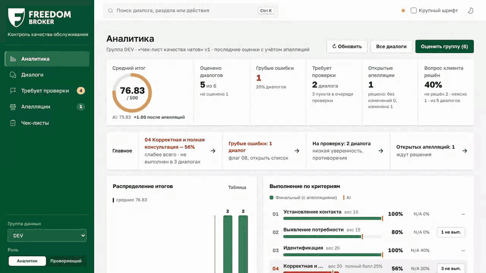
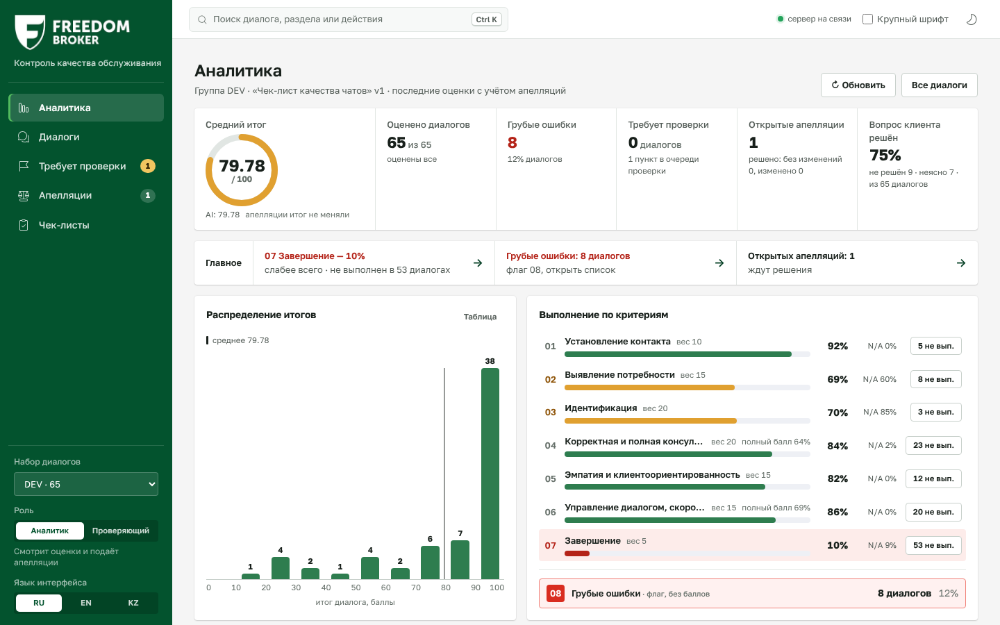
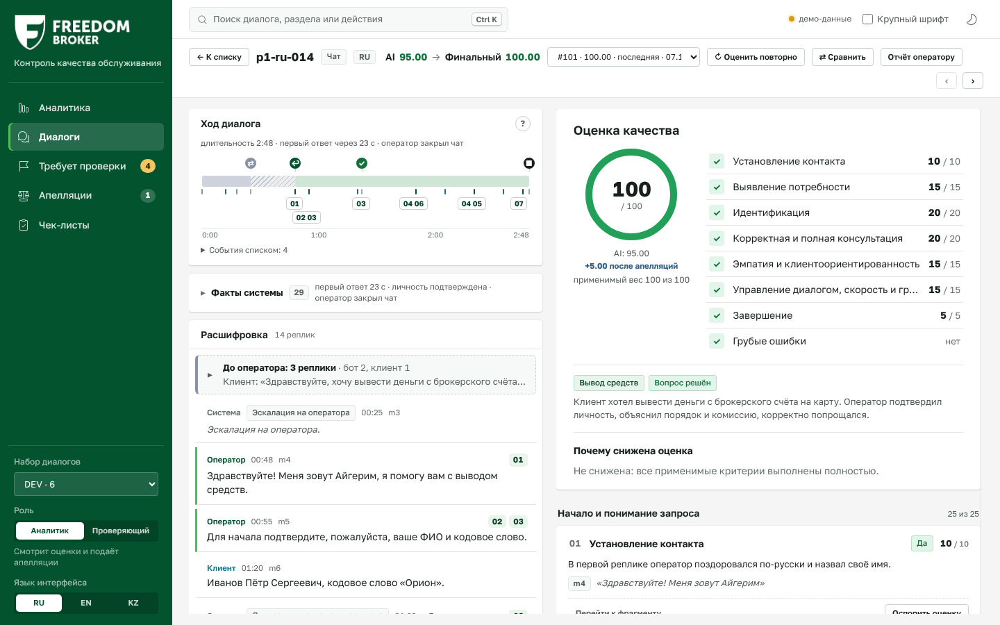
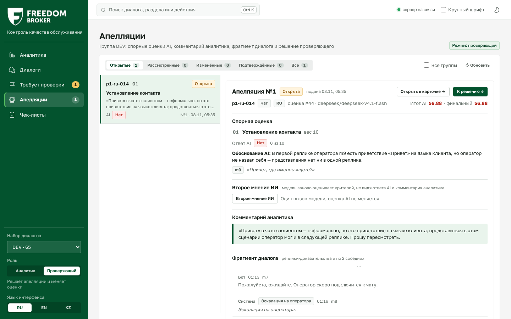
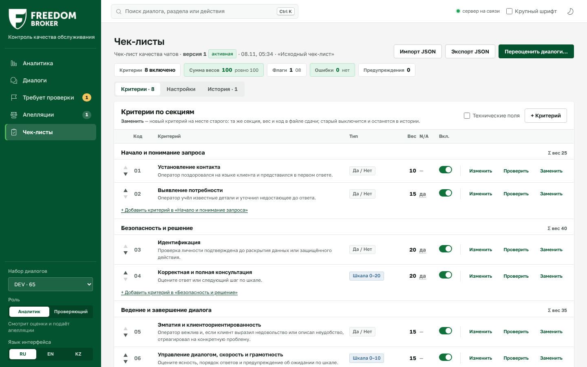

# CQA — Conversation Quality Analytics для Freedom Broker

**Команда Data Mage.** Прототип системы контроля качества, который оценивает работу оператора в чате или звонке по настраиваемому чек-листу. По каждому критерию система показывает ответ, баллы, обоснование и реплику-доказательство, а итог считает по правилам чек-листа. Оценку можно оспорить: проверяющий подтверждает или меняет ответ, итог пересчитывается, исходная оценка AI сохраняется.



*Основной сценарий за 20 секунд: список диалогов, карточка с грубой ошибкой, переход к реплике-доказательству, апелляция и очередь проверяющего. Запись сделана в режиме `?mock=1`, данные в ней вымышленные.*

## Коротко

| | |
|---|---|
| Точность на отложенной выборке (holdout, 28 диалогов) | согласие по критериям **0.90**, средняя ошибка итога **3.2 балла** из 100 |
| Грубые ошибки (критерий 08) | recall 1.0, precision 1.0 |
| Модель и стоимость | `deepseek/deepseek-v4.1-flash` через OpenRouter, 4 вызова на диалог, **≈ $0.004 за одну оценку** с учётом всех вызовов (весь DEV, 65 диалогов: $0.25 за 152 с) |
| Языки и каналы | чаты RU, KZ, EN и звонки RU; бот и системные события — контекст, оценивается только оператор |
| Чек-лист | данные, а не код: критерий добавляется, меняется или заменяется в интерфейсе и сразу работает, старые оценки остаются на своей версии |
| Файлы сдачи | `results/dev/results.json` (65 диалогов, формат организаторов 1.0) и `results/prod/results.json` (контроль FBroker, 10 чатов) |

Презентация — [`docs/presentation/CQA-Data-Mage.pdf`](docs/presentation/CQA-Data-Mage.pdf). Подробное описание по критериям отбора — [`docs/SUBMISSION.md`](docs/SUBMISSION.md).

**Содержание:** [Сценарии использования](#сценарии-использования) · [Сильные стороны](#сильные-стороны) · [Ограничения](#ограничения) · [Быстрый старт](#быстрый-старт) · [Как устроена оценка](#как-устроена-оценка) · [Точность](#точность) · [Экраны и функции](#экраны-и-функции) · [Изменение чек-листа](#изменение-чек-листа) · [Контрольный прогон](#контрольный-прогон) · [Настройки и команды](#настройки-и-команды) · [Структура проекта](#структура-проекта) · [Масштабирование](#масштабирование)

## Сценарии использования

Скриншоты сделаны на реальных диалогах DEV с оценками из `results/dev/results.json` (основная модель, промпт p3); апелляция на скриншоте подана для примера.

**1. Руководитель смотрит качество группы.** «Аналитика» показывает средний итог AI и после апелляций, грубые ошибки, слабые критерии, очередь проверки и открытые апелляции. Клик по любой цифре открывает список диалогов с этим фильтром.



**2. Аналитик разбирает диалог.** В карточке слева таймлайн и расшифровка, справа итог и баллы по каждому критерию с обоснованием и цитатой. Клик по цитате подсвечивает реплику, у звонка запись перематывается на нужную секунду. «Оспорить оценку» подаёт апелляцию с комментарием.



**3. Проверяющий решает апелляцию.** В режиме «Проверяющий» видны спорный ответ AI, обоснование, комментарий аналитика и фрагмент диалога. Проверяющий подтверждает или меняет ответ с причиной, итог пересчитывается, а исходная оценка AI сохраняется. «Второе мнение ИИ» вслепую переоценивает спорный критерий.



**4. Методолог меняет чек-лист.** В «Чек-листах» можно добавить, изменить, заменить или выключить критерий, поменять вес, а черновик нового критерия проверить на 1–5 диалогах. Сохранение создаёт новую версию. «Переоценить диалоги…» запускает переоценку: при смене весов модель не вызывается, по изменённому критерию делается один вызов на диалог.



**5. Проверка неуверенных оценок.** «Требует проверки» собирает критерии с низкой уверенностью модели, ошибкой проверки цитаты или противоречием фактам. Проверяющий начинает с них и не перечитывает все диалоги.

**6. Контроль и сдача.** Новый набор загружается по `group_id` («Импорт набора» или `scripts/control.py`), затем «Оценить группу» и «Экспорт ▾» → «Файл сдачи (results.json)» с проверкой формата. Подробнее — в разделе [Контрольный прогон](#контрольный-прогон).

## Сильные стороны

- **Модель классифицирует, код считает.** LLM только выбирает ответ из допустимых вариантов и цитирует реплики. Факты о диалоге (задержка ответа, паузы, системные события, кто завершил) считает код, баллы и итог — тоже код (`scoring.py`, закреплён тестами на примерах из чек-листа и от организаторов).
- **Каждое утверждение проверяемо.** Цитата сверяется с текстом реплики, выдуманная цитата не проходит. У «Нет» есть проверенный участок, у N/A — причина. Клик по доказательству ведёт к реплике или к секунде записи звонка.
- **Не придумывает при нехватке данных.** Низкая уверенность и противоречия правилам-страховкам отправляют критерий в очередь «Требует проверки», ответ модели не подменяется.
- **Полный процесс в интерфейсе:** импорт набора → оценка → карточка → апелляция → решение проверяющего → правка чек-листа → переоценка только изменённого → экспорт, в том числе файла сдачи.
- **Дёшево и быстро без потери точности.** Модели в 12–35 раз дороже на наших данных не дали заметного выигрыша (таблица ниже), поэтому выбрана быстрая модель за $0.004 за диалог. Модель меняется одной настройкой.
- **Честность и воспроизводимость.** Заготовленных результатов нет: каждая оценка — реальный вызов LLM, в БД хранятся модель, версии промпта и чек-листа, полный промпт, сырой ответ, токены, стоимость и время. Всё это видно в карточке.
- **Звонки как устная речь.** Оговорки и ошибки распознавания не считаются ошибкой оператора, консультации с коллегой на удержании помечаются внутренними, плеер записи с дорожками ролей.
- **Контроль прошёл одной командой.** Контрольный набор FBroker (10 чатов) оценён `control.py` за 26 с и $0.04, 10 из 10 без ошибок, файл сдачи прошёл независимую проверку `validate_results.py`. Итоги и что поймано — в разделе [Контрольный прогон](#контрольный-прогон).
- **Правка чек-листа без лишних трат.** Смена только весов пересчитывает итоги кодом без единого вызова модели, изменённый критерий — один вызов на диалог; решения по апелляциям переносятся на новую оценку.
- **Безопасность.** Ключи и подписанный адрес API — только в `.env`; запись звонка идёт через прокси бэкенда, который не пускает к внутренним адресам; персональные данные маскируются перед отправкой в модель.
- **Готовность к Dynamics 365.** Каждый экран — компонент `mount(el, params)` на чистом HTML/CSS/JS без сборки, который берёт параметры из query-строки; интерфейс на русском, английском и казахском.

## Ограничения

- **Эталон наш, а не организаторов.** Точность измерена на собственной разметке DEV; на контроле эталон организаторов может читать спорные критерии (особенно шкалы 04 и 06) иначе. Мы меряем близость и обоснованность и не пытались угадать их методику.
- **Разброс между одинаковыми прогонами.** Повтор тех же 10 диалогов дал тот же ответ по 91 % критериев; на 30 вручную проверенных диалогах согласие между прогонами 0.83–0.85, MAE 6.1–6.6. Поэтому малые различия между моделями и версиями промпта мы не считаем значимыми.
- **Слабые места модели** — шкалы 04 (полнота консультации) и 06 (ведение диалога): здесь расхождения с эталоном больше всего, хотя почти всегда в пределах одной ступени.
- **Промпт-инъекции.** Текст в реплике клиента, похожий на системное событие («Личность клиента подтверждена»), может сбить критерий 03. Защитное правило в промпте мы замерили (согласие на 30 проверенных диалогах 0.848 → 0.829, в пределах шума, но не в пользу правила) и не включили: приоритет — точность на контроле.
- **Облачная модель.** Основной путь — OpenRouter; локальная модель через Ollama подключается тем же интерфейсом провайдера, но на данных мы её не замеряли, локальной LLM в решении нет.
- **Своей транскрибации нет:** расшифровки звонков выданы организаторами. Темп, дикцию и интонацию по расшифровке не оцениваем.
- **Прототип, а не продакшн:** нет входа и ролей (переключатель «Аналитик / Проверяющий»), нет публичного деплоя (организаторы подтвердили, что он не нужен), SQLite без миграций, фоновые прогоны — потоки внутри процесса.

## Быстрый старт

Нужен Python 3.11. Команды выполняются из корня репозитория.

```bash
uv venv -p 3.11 .venv && source .venv/bin/activate   # или: python3.11 -m venv .venv
uv pip install -r requirements.txt                   # или: pip install -r requirements.txt
cp .env.example .env                                 # ключ OpenRouter и адрес API организаторов
python scripts/fetch_dataset.py                      # DEV из API организаторов → data/raw/DEV.json
python scripts/reset_db.py --import data/raw/DEV.json
uvicorn backend.app.main:app                         # http://localhost:8000
```

- Без сети: `python scripts/fetch_dataset.py --from-file <файл.json>` (JSON в формате API организаторов).
- Без бэкенда и ключей: откройте http://localhost:8000/?mock=1 — все экраны работают на вымышленных данных из `frontend/fixtures/`.
- При старте сервер подхватывает оценки DEV из `results/dev/results.json`, если в БД их ещё нет, поэтому интерфейс сразу показывает результаты без новых вызовов модели (в карточке метка «Из файла результатов»). Обзор диалога (резюме, тема, решён ли вопрос) для DEV взят из отдельного прогона той же модели и промпта (`data/results_extras/dev_overview.json`), ответы по критериям — из `results.json`.
- `--reload` — только для разработки: перезапуск обрывает идущий фоновый прогон.
- Проверка: `curl localhost:8000/api/health`, документация API — http://localhost:8000/docs, тесты — `pytest -q` (255 тестов, во внешние API не ходят).

<details>
<summary><b>Docker (необязательно)</b></summary>

```bash
cp .env.example .env          # ORGANIZER_API_URL и ключ OpenRouter
docker compose up --build     # http://localhost:8000
```

При первом старте контейнер скачивает DEV из API организаторов и импортирует его; без `ORGANIZER_API_URL` сервер стартует без диалогов (экраны работают на `?mock=1`). БД и скачанные наборы лежат в томах `cqa-db` и `cqa-raw`, папка `results/` смонтирована с хоста. Контрольный прогон в контейнере: `docker compose exec cqa python scripts/control.py …` (аргументы — в разделе «Контрольный прогон»). Сбросить БД: `docker compose down -v`.

</details>

<details>
<summary><b>Windows (PowerShell)</b></summary>

```powershell
$env:PYTHONUTF8 = "1"; [Console]::OutputEncoding = [System.Text.Encoding]::UTF8   # кириллица в выводе
Set-ExecutionPolicy -Scope Process -ExecutionPolicy Bypass                        # если блокируется Activate.ps1
py -3.11 -m venv .venv                                                            # или: uv venv -p 3.11 .venv
.venv\Scripts\Activate.ps1
python -m pip install -r requirements.txt
Copy-Item .env.example .env                                                       # заполнить: notepad .env
python scripts/fetch_dataset.py
python scripts/reset_db.py --import data/raw/DEV.json
uvicorn backend.app.main:app
```

Проверка: `Invoke-RestMethod http://localhost:8000/api/health`. CSV-выгрузка — UTF-8 с BOM и разделителем `;`, поэтому открывается в Excel без искажения кириллицы и казахских букв.

</details>

## Как устроена оценка

```
транскрипт ─► нормализация ─► факты (код) ─► промпт из чек-листа в БД ─► LLM × 4 вызова (параллельно)
                                                                                │  строгий JSON
           итог ◄── баллы (код) ◄── страховки (код) ◄── проверка ответа и цитат ◄─┘  (1 повтор)
```

1. **Нормализация** (`backend/app/services/normalize.py`). Реплики получают номера `m0, m1, …` и время в секундах (`MM:SS` у чатов, ISO 8601 у звонков). У звонков выделяются удержания, консультации с коллегой и паузы записи; отсюда смещение каждой реплики в записи.
2. **Факты кодом** (`backend/app/services/facts/`). Первая реплика оператора и её язык, приветствие и представление, задержка первого ответа, долгие паузы и было ли предупреждение, системные события (личность подтверждена, связь прервалась, клиент ушёл), кто завершил диалог, прощание, рискованные фразы. Словари фраз RU / KZ / EN лежат в `data/config/` и дополняются без кода. Модель получает факты как подсказку, решение остаётся за ней.
3. **Промпт из чек-листа в БД** (`backend/app/services/prompt_builder.py`, шаблоны в `backend/app/prompts/`). Общие правила оценки, факты, транскрипт с номерами реплик и критерии этого вызова из активной версии чек-листа: формулировка, «Да, когда…», «Нет, когда…», условие N/A, ступени шкалы, подсказка оценщику. В коде нет ветвлений по коду критерия, примеров и цитат из DEV в промпте нет.
4. **LLM классифицирует и цитирует.** JSON-схема строится под каждый вызов: N/A есть только там, где он разрешён, у шкалы — только её ступени. Модель пишет рассуждение, затем ответ, доказательства (номер реплики и цитата), проверенный участок, причину N/A, уверенность и рекомендацию. Стратегия `grouped`: 01-02-03-05-07 одним вызовом, 04, 06 и 08 — отдельными (также есть `single` и `per_criterion`).
5. **Проверка ответа** (`backend/app/services/validator.py`). Все критерии на месте, ответ допустимый, реплика существует, цитата есть в её тексте (нечёткое совпадение: порог 0.85 у чатов, 0.75 у звонков), ответ не обрезан. При ошибке — один повтор с перечнем ошибок; если и он не прошёл, сохраняется лучший вариант с пометкой «требует проверки».
6. **Страховки** (`backend/app/services/guards.py`). Правила в данных критерия подсвечивают противоречие фактам (например, «Да» по идентификации без события подтверждения в чате) и ставят критерий в очередь проверки.
7. **Баллы кодом** (`backend/app/services/scoring.py`). «Да» — полный вес, «Нет» — 0, шкала — `вес × ступень / максимум`. N/A исключает критерий из применимого веса: итог = сумма баллов / сумма применимых весов × 100, округление до 2 знаков половиной вверх. Критерий 08 — флаг без баллов. Пример из чек-листа даёт 94.38, пример организаторов — 85.38; оба закреплены тестами.

**Звонки.** Для звонков в промпт добавляются правила канала (`backend/app/prompts/channel_voice.md`) и подсказки критериев для звонков (`voice_guidance`). Если в записи нет приветствия, 01 оценивается по тому, что есть в записи, со сниженной уверенностью: в формате сдачи у `contact` нет N/A.

**Неполные данные.** Если информации не хватает, модель так и пишет и ставит низкую уверенность. Справка о продуктах (`data/knowledge/freedom_broker_kb.md`) подключена к критерию 04 как подсказка, а не эталон.

Подробно — [`docs/architecture/evaluation-pipeline.md`](docs/architecture/evaluation-pipeline.md).

## Точность

Близость к эталону мы меряем на своей разметке всего DEV: 65 диалогов (чаты RU 30, KZ 15, EN 15 и 5 звонков). 30 диалогов проверены вручную, остальные 35 — черновик разметки по тем же правилам, поэтому главные цифры даём и на проверенной части. Разбиение dev 37 / holdout 28 зафиксировано в `data/gold/split.json` до прогонов; промпт правили только по dev. Метрики считает `eval/run_eval.py`, таблицы собирает `eval/report.py`.

Основная конфигурация (`deepseek/deepseek-v4.1-flash`, `grouped`, рассуждения `low`, промпт p3):

| Выборка | Согласие по критериям 01–08 | MAE итога, баллы |
|---|---|---|
| holdout (28) | **0.90** (95% ДИ 0.86–0.93) | **3.2** (2.6–6.5) |
| dev (37) | 0.89 | 5.3 |
| проверенные вручную (30) | 0.84 | 7.1 |

Флаг 08 (грубая ошибка): recall / precision — 1.0 / 1.0. Разброс одного и того же прогона — до ±1.5 балла MAE.

**Модель × точность × цена** (holdout 28, промпт p2, одинаковые настройки; цена и время — фактические из `usage` OpenRouter, медиана времени на диалог):

| Модель | Согласие | MAE итога | Итог в ±10 | $ на диалог | с на диалог |
|---|---|---|---|---|---|
| deepseek/deepseek-v4-pro | **0.92** | 3.7 | 0.86 | 0.048 | 53 |
| google/gemini-3.1-pro-preview | 0.90 | 4.1 | 0.86 | 0.067 | 10 |
| anthropic/claude-opus-5.5 ¹ | 0.89 | 6.2 | 0.71 | 0.143 | 12 |
| **deepseek/deepseek-v4.1-flash** (выбрана) | 0.89 | **3.5** | 0.86 | **0.004** | 8 |
| openai/gpt-5.6-terra | 0.88 | 3.9 | **0.89** | 0.050 | 5 |
| anthropic/claude-sonnet-5.5 ¹ | 0.88 | 7.7 | 0.68 | 0.072 | 9 |

¹ Черновик эталона готовился с помощью модели семейства Claude, поэтому у этих моделей согласие может быть немного завышено; на итоге это не видно.

**Почему V4.1 Flash.** Модели в 12–35 раз дороже дают +0.00–0.03 согласия и не уменьшают ошибку итога. V4 Pro точнее по критериям, но в 12 раз дороже и в 6–7 раз медленнее. Если компании важнее последние проценты точности, модель меняется настройкой `OPENROUTER_MODEL`.

**Что пробовали.**
- Промпт p2: грубая ошибка отмечается только флагом 08 и не снижает другие критерии повторно.
- Промпт p3: в подсказки 02, 04 и 07 записаны правила разметки (полноту ответа оценивает только 04; передача без срока — не выше 15; повтор инструкции с прощанием — не итог). Holdout: согласие 0.89 → 0.90, MAE 3.5 → 3.2.
- Голосование трёх прогонов (большинство / медиана) прироста не дало при тройной цене — не включили.
- Первая волна сравнения из шести моделей (Gemini 3.8 Flash, GPT-5.6 Luna, Qwen3.8 Flash, Claude Haiku 5.5 и др.) — [`docs/research/03-model-bakeoff.md`](docs/research/03-model-bakeoff.md).

Все прогоны сравнения, разработки и проверок стоили около $15.

**Откуда эталон.** Черновики разметки готовились в рабочей сессии разработки, без API продукта. 30 диалогов проверены вручную (в первых 24 изменено 8 ответов из 192), для спорных мест записаны правила разметки (07, 04, звонки — [`docs/DECISIONS.md`](docs/DECISIONS.md)). Вторая независимая разметка 22 чатов совпала с эталоном в 146 из 176 ответов. Эталон в промпт не попадает и используется только в `eval/run_eval.py`. Методика — [`docs/architecture/quality-eval.md`](docs/architecture/quality-eval.md).

## Экраны и функции

Интерфейс — одна страница в корпоративном стиле Freedom: http://localhost:8000. Слева меню «Аналитика / Диалоги / Требует проверки / Апелляции / Чек-листы», внизу меню — «Набор диалогов» (например, «DEV · 65» или контрольный набор), режим «Аналитик / Проверяющий» с подсказкой, что доступно в каждой роли, и язык интерфейса RU / EN / KZ. Сверху — поиск и палитра команд (Ctrl+K), крупный шрифт для проектора, светлая и тёмная тема.

| Экран | Адрес | Что на нём |
|---|---|---|
| Аналитика (стартовый) | `#/dashboard` | Средний итог AI и финальный, распределение итогов, выполнение по критериям, разрезы по языкам и каналам, грубые ошибки, открытые апелляции, темы обращений и доля решённых вопросов. Клик по цифре открывает список с этим фильтром. |
| Диалоги | `#/conversations` | Таблица с итогом AI и финальным, флагом грубой ошибки, критериями, апелляциями. Фильтры, поиск, «Оценить», импорт набора, выгрузки. |
| Карточка диалога | `#/conversation/<id>` | Слева расшифровка, справа результат по критериям (подробно ниже). |
| Требует проверки | `#/review` | Критерии с низкой уверенностью, ошибкой проверки, противоречием страховке или без ответа. |
| Апелляции | `#/appeals` | Очередь проверяющего: спорная оценка, обоснование AI, комментарий, фрагмент диалога, форма решения. «Второе мнение ИИ» — слепая переоценка спорного критерия одним вызовом, оценка при этом не меняется. |
| Чек-листы | `#/checklist` | Конструктор с версиями (см. [Изменение чек-листа](#изменение-чек-листа)). |
| Сравнение оценок | `#/compare?...` | Две оценки одного диалога: разница конфигурации и итога, изменённые критерии первыми. |
| Новый диалог | `#/new` | Вставить транскрипт текстом (`[MM:SS] Роль: текст`) или JSON, посмотреть разбор и сразу оценить. |

**Карточка диалога.**
- Расшифровка с ролями, временем и номерами реплик; бот и системные события приглушены. Таймлайн: эскалация, первый ответ с задержкой, подтверждение личности, паузы, завершение.
- Обзор: резюме, тема обращения, решён ли вопрос. Блок «Почему снижена оценка» с кнопками «Перейти к фрагменту» и «Оспорить оценку».
- По каждому критерию: ответ, баллы и вес, вклад в итог, обоснование, уверенность, рекомендация оператору. Клик по доказательству подсвечивает реплику или диапазон.
- Звонок: плеер с волной по дорожкам «Клиент / Оператор / Бот»; клик по реплике ставит запись на нужную секунду. Запись идёт через бэкенд, подписанная ссылка в браузер не попадает.
- Метаданные: провайдер, модель, стратегия, версии чек-листа и промпта, токены, стоимость, время. «Сырой ответ» показывает каждый вызов LLM: полный промпт, параметры, ответ модели как есть.
- «Оценить повторно» и переключатель прошлых оценок; после повторной оценки — сколько критериев изменилось и экран сравнения.
- Апелляция: аналитик оспаривает критерий с комментарием, проверяющий подтверждает или меняет ответ с причиной; видны три слоя «AI → решение → финальный», итог пересчитывается.
- Коучинг-отчёт оператору с печатью в PDF.

**Окно «Оценить».** Версия чек-листа, провайдер и модель, стратегия, область (выбранные диалоги или группа), «Использовать прошлые ответы». До запуска показывает число вызовов, токенов, стоимость и время без вызова LLM; во время прогона — прогресс.

**Выгрузки.** CSV для Excel, JSON с обоснованиями и апелляциями, файл сдачи `results.json` в формате организаторов с проверкой формата.

**Приватность.** Перед отправкой в модель персональные данные (номера карт, ИИН, IBAN, телефоны, e-mail, коды из SMS, номера счетов и договоров) заменяются метками вида `[PHONE_1]`; оригинал остаётся только в нашей БД (`PII_MASKING=true` по умолчанию).

**Отдельные страницы под Dynamics 365.** Тонкие страницы `frontend/pages/*.html` открывают компонент отдельно, как будущий HTML web resource: `/pages/conversation-card.html?id=<id>`, `/pages/dashboard.html?group=DEV`. Адрес бэкенда — параметр `?api=` или `window.CQA_API_BASE`, язык — `?lang=en|kk`.

## Изменение чек-листа

Чек-лист хранится в БД как версионируемые данные; промпт и JSON-схема ответа строятся из него при каждом вызове.

- **Добавить, изменить, удалить критерий** в «Чек-листы»: название, секция, тип (`binary`, `scale`, `flag`), вес, формулировка, «Да, когда…», «Нет, когда…», N/A и его условие, ступени шкалы, подсказка оценщику и для звонков, правила-страховки, код для файла сдачи.
- **«Заменить критерий»** в один шаг: новый встаёт на место старого с той же секцией, весом и кодом в файле сдачи.
- **«Черновик с ИИ»**: опишите одной-двумя фразами, что проверять, — модель заполнит формулировки и ступени в стиле текущего чек-листа; код, секцию и вес задаёт человек.
- **«Проверить»**: песочница критерия — прогнать черновик на 1–5 диалогах до сохранения, не меняя их оценок.
- **Сохранение** создаёт новую неизменяемую версию; старые оценки остаются на своей. Поля проверяются до сохранения, сервер предупреждает, если версия не ложится в формат файла сдачи.
- **«Переоценить диалоги…»** после сохранения: смена весов пересчитывает итоги кодом без вызовов LLM, изменённый или новый критерий — один вызов на диалог, остальные ответы переиспользуются по хешу критерия.

## Контрольный прогон

Организаторы выдают 10 новых чатов по новому `group_id` и просят заменить один критерий через интерфейс. Файл сдачи — `results/prod/results.json` в формате [`docs/task/results-format.md`](docs/task/results-format.md).

```bash
python scripts/sync_default_checklist.py              # активный чек-лист = data/checklists/default.json
python scripts/control.py --group <group_id> --target prod --expect-count 10 --approved "<кто разрешил платный прогон>"
python scripts/validate_results.py results/prod/results.json prod   # независимая проверка по правилам организаторов
git add results/prod/results.json && git commit -m "results: control run" && git push
```

`control.py` проверяет, что чек-лист ложится в формат сдачи, сохраняет снапшот, импортирует набор, оценивает все диалоги, повторяет неудачные (дозапрашивая только недостающие критерии), пишет и проверяет файл. Диалог, который не удалось оценить, попадает в файл со `status: "error"` и причиной. Повторный запуск после сбоя — с `--reuse auto`, без новых трат на готовые ответы. Набор, выданный файлом, — `--file <файл.json>`.

**То же без командной строки:** «Диалоги» → «Импорт набора» → «Из API организаторов» → «Оценить группу» → «Экспорт ▾» → «Файл сдачи (results.json)».

**Замена критерия:** «Чек-листы» → «Заменить» у критерия → поля нового критерия → «Сохранить как новую версию» → «Переоценить диалоги…» → «Запустить». Неизменённые критерии переиспользуются, новый оценивается одним вызовом на диалог.

### Итог контроля FBroker (08.11, 06:03 UTC)

Одна команда `control.py --group FBroker`, модель `deepseek/deepseek-v4.1-flash`, `grouped`, исходный чек-лист v1: 10 из 10 диалогов, 26 с, $0.04. `validate_results.py` — OK.

| Диалог | Итог | Флаг 08 | Что нашла система |
|---|---|---|---|
| p2-ru-001 | 92.31 | — | |
| p2-ru-002 | 38.75 | — | главный вопрос клиента (когда повторить вывод) остался без ответа |
| p2-ru-003 | 90.00 | — | |
| p2-ru-004 | 11.00 | **да** | ограничение по счёту раскрыто без подтверждения личности (03 «Нет», 08) |
| p2-kz-001 | 88.13 | — | |
| p2-kz-002 | 12.50 | — | заведомо неверный совет («отклонённая заявка исполнена, ничего не проверяйте») — 04 = 0 |
| p2-kz-003 | 84.62 | **да** | оператор предлагает перевести деньги ему лично — услуга в обход компании |
| p2-kz-004 | 100.00 | — | |
| p2-en-001 | 82.50 | — | |
| p2-en-002 | 100.00 | — | |

Ложная информация в чек-листе организаторов не входит в грубые ошибки 08 (там только оскорбление, услуга в обход компании и раскрытие данных), поэтому p2-kz-002 наказан через полноту консультации, а не флагом.

### Дополнительный набор SWAP

Организаторы попросили пока только сохранить набор SWAP (3 чата) и не добавлять его в `results/prod`. Набор берётся тем же GET с `group_id=Swap` и сохраняется в `data/raw/Swap.json` (папка не коммитится, как и DEV):

```bash
python scripts/fetch_dataset.py --group Swap                      # или --from-file <файл.json>
python scripts/control.py --group Swap --file data/raw/Swap.json --target dev --expect-count 3 \
  --approved "<кто разрешил>"   # пример; цель и чек-лист — по дополнительной инструкции организаторов
```

Если по инструкции нужно заменить критерий, сначала замените его в «Чек-листах», затем запустите оценку с `--version <id>` новой версии. `results/prod/results.json` при этом не трогать.

Файл сдачи собирается по исходному чек-листу, до замены критерия: эталон организаторов составлен по нему. Пересобрать по конкретной версии: `python scripts/export_results.py --group <group_id> --version <id> --out results/prod/results.json --expect-count 10`. В файл идут ответы AI, а не решения по апелляциям.

## Настройки и команды

Ключи и адреса — только в `.env` (шаблон `.env.example`), он не коммитится.

| Переменная | Что это |
|---|---|
| `ORGANIZER_API_URL` | Адрес API организаторов из гайда. В нём подпись `sig` — секрет, только в `.env`. `group_id` приложение подставляет само. |
| `DATASET_GROUP_ID` | Группа по умолчанию (`DEV`). |
| `LLM_PROVIDER` | `openrouter`, `gemini` или `ollama`. |
| `OPENROUTER_API_KEY`, `OPENROUTER_MODEL` | Основной провайдер (платный). Модель — id из каталога OpenRouter. |
| `GEMINI_API_KEY`, `GEMINI_MODEL` | Бесплатный ключ Google AI Studio — только для отладки на синтетических диалогах; отправка звонков в него запрещена в коде провайдера. |
| `OLLAMA_BASE_URL`, `OLLAMA_MODEL` | Локальная модель через Ollama, необязательно. |
| `DATABASE_URL` | По умолчанию SQLite `data/cqa.db`. |
| `PII_MASKING` | Маскирование персональных данных перед моделью (по умолчанию `true`). |
| `TEAM_NAME`, `MODEL_MODE` | Поля файла сдачи (`MODEL_MODE`: `local`, `external_api`, `hybrid`). |
| `OPENROUTER_CONCURRENCY`, `GEMINI_CONCURRENCY`, `EVAL_STRATEGY` | Параллельность вызовов (по умолчанию 8 и 2) и стратегия по умолчанию (`grouped`). |

| Команда | Что делает |
|---|---|
| `python scripts/fetch_dataset.py [--group <id>] [--from-file <файл>]` | Снапшот набора в `data/raw/<group>.json` |
| `python scripts/reset_db.py --import data/raw/DEV.json` | Новая БД с чек-листом по умолчанию и импортом набора |
| `python scripts/sync_default_checklist.py [--dry-run]` | Новая версия чек-листа из `data/checklists/default.json` |
| `python scripts/import_results.py` | Загрузить оценки из `results/dev/results.json` в БД без вызовов модели |
| `python scripts/fetch_audio.py [--from-dir <папка>]` | Записи звонков в `data/audio/` (не в git) |
| `python eval/run_eval.py --provider openrouter --model <id> --split dev --approved "<…>"` | Прогон против эталона; `--repeat 2` — стабильность, `--metrics-only <файл>` — пересчёт без вызовов |
| `python eval/report.py` | Таблицы метрик из сохранённых прогонов |
| `pytest -q` | Тесты (сеть и провайдеры подменены) |

Набор можно добавить и в работающую БД: «Импорт набора» в интерфейсе, `POST /api/datasets/import` с `{"group_id": "..."}` или `POST /api/datasets/upload` с файлом. Оценка через API — `POST /api/runs`, прогресс — `GET /api/runs/{id}`.

## Структура проекта

```
backend/app/
  api/          эндпоинты: datasets, conversations, audio, checklists, runs, evaluations, appeals, analytics, export
  services/     normalize, facts/, prompt_builder, judge, validator, guards, scoring, evaluator, reuse, runs,
                appeals, review, analytics, compare, pii, results_export
  providers/    LLMProvider на OpenAI-совместимом API: openrouter, gemini, ollama; цены моделей
  prompts/      шаблоны промпта и их версия
frontend/       index.html, js/ (api.js, роутер, components/), pages/ (страницы под Dynamics 365), css/, fixtures/
data/
  checklists/   чек-лист по умолчанию (8 критериев, 4 секции)
  config/       словари фраз и системных событий RU / KZ / EN
  knowledge/    справка о продуктах для критерия 04
  gold/         эталонная разметка DEV: выборка, разбиение, черновики, вторая разметка, итог
eval/           run_eval.py, metrics.py, report.py
scripts/        fetch_dataset, reset_db, control, export_results, validate_results, sync_default_checklist и др.
results/        файлы сдачи dev/ и prod/
tests/          pytest
docs/           задание, ТЗ, архитектура, контракты API, решения (ADR), исследования, чек-лист
```

Документация: чек-лист — [`docs/checklist.md`](docs/checklist.md), архитектура — [`docs/architecture/README.md`](docs/architecture/README.md), ТЗ — [`docs/spec/requirements.md`](docs/spec/requirements.md), контракты API — [`docs/CONTRACTS.md`](docs/CONTRACTS.md), решения — [`docs/DECISIONS.md`](docs/DECISIONS.md), карта — [`docs/README.md`](docs/README.md).

## Масштабирование

- **Провайдер за интерфейсом.** Облачная модель, другой агрегатор или локальная модель подключаются настройкой, без правки конвейера.
- **Параллельные вызовы.** Вызовы одного диалога и диалоги прогона идут параллельно, лимит одновременных запросов — на провайдера; 429 и 5xx повторяются с паузой 2, 4, 8 с.
- **Фоновые прогоны.** `POST /api/runs` сразу отвечает `run_id`, прогресс хранится в БД; при росте нагрузки та же функция переносится в очередь задач с воркерами.
- **Переиспользование ответов.** Хеш каждого критерия охватывает всё, что попадает в промпт; при правке чек-листа заново оцениваются только изменённые критерии.
- **Кеш префикса.** Общая часть промпта (правила, факты, транскрипт) идёт первой, провайдеры с кешированием префикса берут за неё меньше.
- **Хранилище.** SQLModel с адресом из `DATABASE_URL`: SQLite для прототипа, PostgreSQL — сменой адреса (на прототипе не проверяли). Изменчивые поля — JSON-колонки.
- **Без состояния в памяти.** Всё состояние в БД, фронт — статика без сборки, адрес API задаётся параметром.
